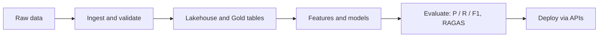

<!-- HEADER -->

---

### 👋 About
2026 Computer Science graduate from NIIT University. I work across the full data path: ingesting and cleaning raw data, shaping it into trustworthy tables, then training and **rigorously evaluating** models on top of it. Published researcher, healthcare-AI intern, and a believer that a model is only as good as its data and its validation.

### 🔁 How I work

### ⚡ Proof, not claims

| | |
|---|---|
| 🏥 **~50%** | faster healthcare data processing after building ingestion and eCQM pipelines |
| 🚀 **~40%** | higher throughput with Ray and Daft distributed workflows vs. single-node |
| 🎯 **91.1% → 95.0%** | recall gain on ECG5000 anomaly detection vs. the baseline paper (F1 0.950 → 0.955) |
| 📄 **Published** | *TinyML on Microcontrollers: A Review*, JARET, Vol. 13, Issue 1, 2026 |
| 🎓 **Certified** | Stanford / DeepLearning.AI Machine Learning Specialization |

### 🧰 Toolbox

<b>Data Engineering</b>

<b>Data Science and ML</b>

<b>GenAI and LLM Evaluation</b>

### 🚧 Featured projects

| Project | What it does | Stack |
|---|---|---|
| [**NeoBank**](link) | Metadata-driven incremental pipeline producing Customer 360, branch performance and risk summaries | Databricks, PySpark, Delta Lake |
| [**QuickSight Retail**](link) | Salesforce, PostgreSQL and CSV sources into a star schema with a Unity Catalog metric view | Databricks, SQL, Unity Catalog |
| [**TinyML Anomaly Detector**](link) | Autoencoder on ECG5000 running within the memory limits of an Arduino Nano BLE Sense Rev 2 | Python, TensorFlow, TinyML |

### 📫 Let's talk
Hiring for data engineering or data science? I'd love to hear about it.

